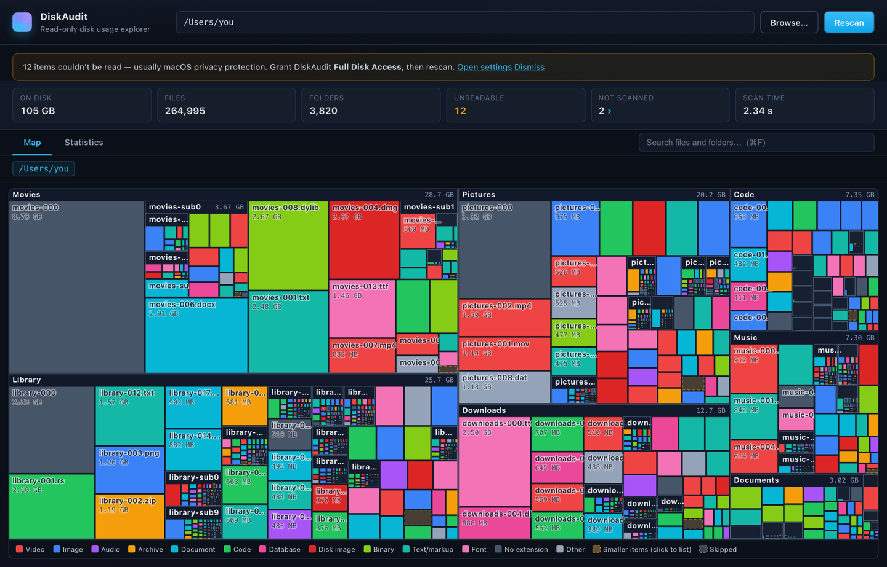
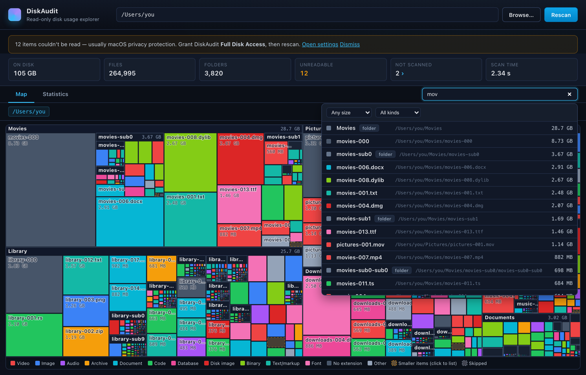
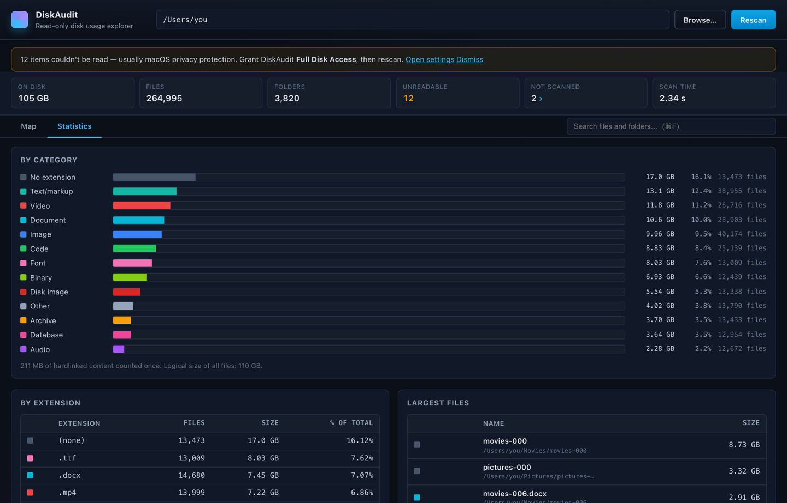
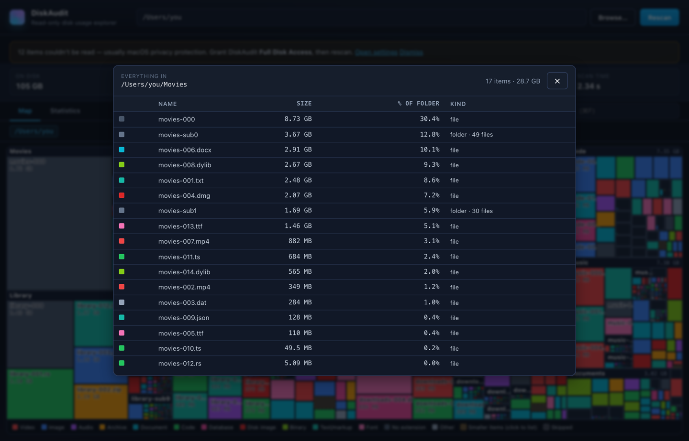
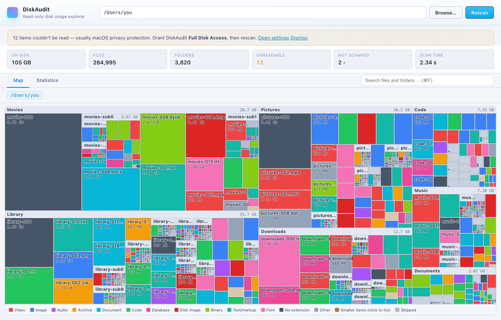

# DiskAudit

**A read-only disk usage visualizer for macOS.** Point it at a folder — or your
whole startup disk — and see every file as a block sized by the space it
actually occupies. Find the big thing, understand what it is, and act on it.



DiskAudit is built around one loop:

1. **Find** — the treemap starts filling in seconds into a scan and keeps
   refining live. The biggest blocks are the answer to "where did my space go?"
2. **Understand** — click to drill in, hover for exact sizes and paths, search
   (⌘F) for things like *every video over 1 GB*, browse category and extension
   statistics, open the full listing behind any "N smaller items" block.
3. **Act** — right-click any file or folder: **Reveal in Finder**, **Copy
   Path**, or **Copy Delete Command** (puts an `rm` command on the clipboard
   for *you* to paste into Terminal — see the guarantee below). Or just drop
   a folder from Finder onto the window to scan it.

| Search anything by size and kind | Complete statistics |
| --- | --- |
|  |  |

| Every "smaller items" block opens a full listing | Light mode |
| --- | --- |
|  |  |

*(Screenshots show the built-in demo dataset rendered by the development
mock — run a scan to see your own disk.)*

## The read-only guarantee

DiskAudit **never writes, moves, renames, or deletes anything**. This is
enforced in three layers:

- The Rust scanner uses only read APIs (`metadata`, `read_dir`, directory
  traversal). There is no code path that opens a file for writing, removes
  anything, or spawns a process. An audited security comment at the top of
  `src-tauri/src/lib.rs` documents the allowed API surface.
- The UI layer (Tauri) is granted **no filesystem capability at all** — just
  the folder-open dialog, "reveal in Finder", and *write-only* clipboard
  access. Each grant is justified in `src-tauri/capabilities/default.json`.
- "Copy Delete Command" only places text on the clipboard. Nothing in the app
  can execute it; deleting remains a deliberate act you perform in Terminal.

## Install / build

Prerequisites: [Rust](https://rustup.rs), Node 20+, Xcode command-line tools.

```bash
npm install
npm run tauri dev     # run in development
npm run tauri build   # produce DiskAudit.app and a .dmg
```

The bundles land in `src-tauri/target/release/bundle/` (`macos/DiskAudit.app`,
`dmg/DiskAudit_*.dmg`). Drag the app to `/Applications`.

## Full Disk Access

macOS privacy protection blocks *every* app from reading Mail, Messages,
Safari data, Time Machine metadata, and parts of `~/Library` until you grant
**Full Disk Access** (System Settings → Privacy & Security → Full Disk
Access). Without it, scans still work but report those places as unreadable —
DiskAudit counts them, shows you how many items it couldn't read, and offers a
button that opens the right settings pane. Grant access and rescan for a
complete picture.

## How DiskAudit measures — and how that relates to Finder

- **Sizes are allocated bytes** (`st_blocks × 512`): the space a file really
  occupies on disk, which is what you get back by deleting it. Finder's Get
  Info headline number is the *logical* size (what the file claims to
  contain); DiskAudit reports the logical total in the statistics view for
  comparison. Sparse files (Docker images, VM disks, some databases) can be
  dramatically smaller on disk than their logical size — DiskAudit shows the
  truth.
- **Units are decimal** (1 MB = 1,000,000 bytes), matching Finder and every
  other macOS surface.
- **Hardlinks are counted once.** Extra links to the same file show as 0 bytes
  and the deduplicated total is reported in the statistics.
- **APFS clones are not deduplicated** — macOS provides no public API to
  detect shared extents. Two clones of a 10 GB file count as 20 GB (Finder
  does the same); actual disk usage may be lower.
- **Scanning `/` shows the startup disk the way Finder presents it**: the
  System and Data volumes merged at their usual paths. The Data volume's
  mount point (`/System/Volumes/Data`) is skipped so nothing is counted
  twice, and helper volumes (Preboot, VM/swap) are listed as skipped.

## What a scan deliberately skips

Nothing disappears silently — every skipped location appears in the map, in
listings, and in the **Not scanned** panel with its reason:

- **Cloud-sync folders** (`~/Library/CloudStorage`, `~/Library/Mobile
  Documents` — iCloud Drive, Dropbox, Google Drive, OneDrive): much of their
  content lives only in the cloud, and reading them can hang on network I/O
  or trigger downloads. Scan one directly (point DiskAudit at it) if you
  really want it measured.
- **Other volumes**: external drives, network shares, mounted disk images,
  and simulator volumes don't occupy space on the disk you're scanning. Scan
  a volume directly to measure it.
- **Symlinks are never followed** (each is counted where it stands, at the
  link's own ~0 size), so nothing is counted twice and scans can't loop.

## Known limitations

- Directory entries themselves (the few KB a huge folder's catalog occupies)
  are not counted, only files. `du` agrees with DiskAudit on APFS to within
  rounding.
- "Purgeable" space that macOS reclaims on demand (local Time Machine
  snapshots, cached iCloud content) is invisible to any user-space walk —
  if Finder's free space disagrees with everyone, snapshots are usually why.
- Which of several hardlinked paths displays the shared size depends on scan
  order.
- The scanner keeps the whole scan in memory to serve drill-in, listing, and
  search queries instantly afterward; very large scans (millions of files)
  cost a few hundred MB of RAM.

## Development

```bash
npx tsc -b --force            # type-check the frontend
npm test                      # frontend tests (vitest)
npm run dev                   # UI in a plain browser against a mock backend
cd src-tauri
cargo test                    # scanner unit tests
cargo run --release --example scan_summary -- ~/Library   # CLI harness, compares to du
```

CI runs `cargo fmt --check`, `cargo check`, `clippy -D warnings`, `cargo
test`, `tsc`, and the vitest suites on every push.

Architecture notes live in [CLAUDE.md](CLAUDE.md).
