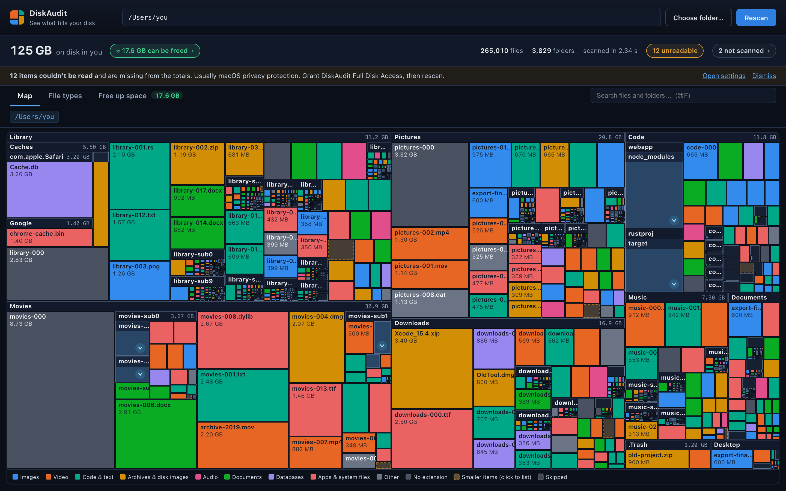
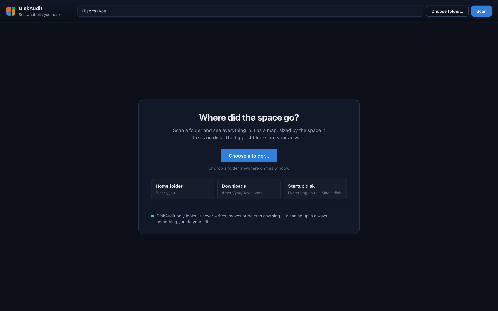
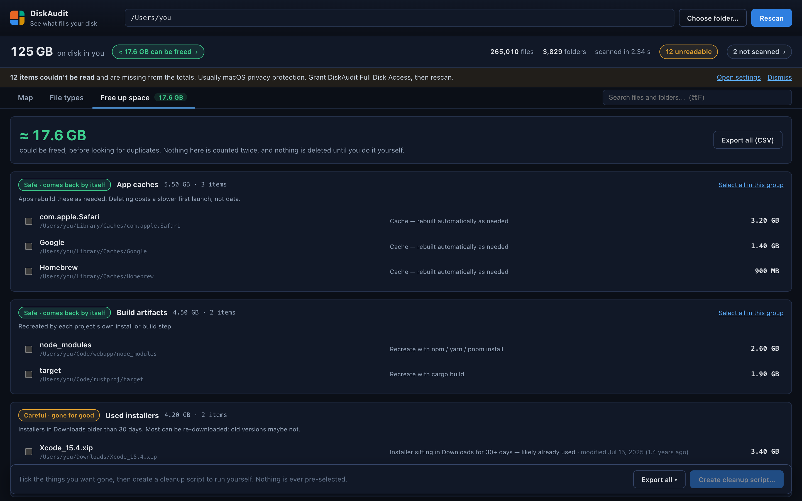
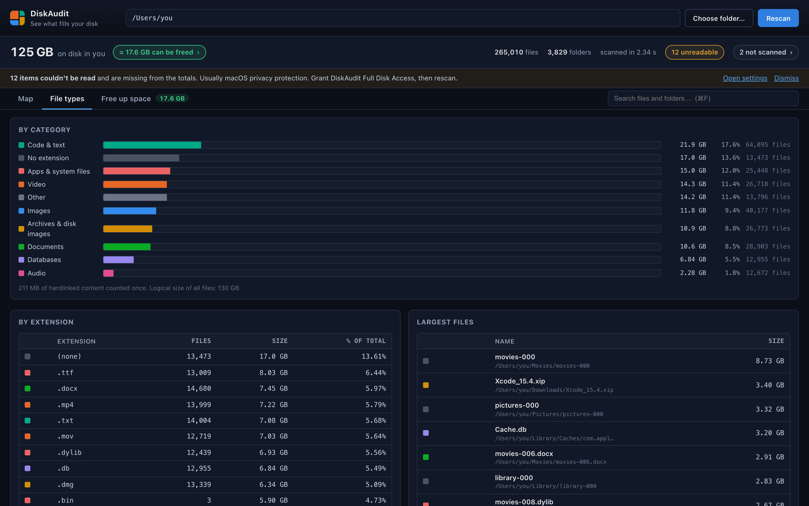
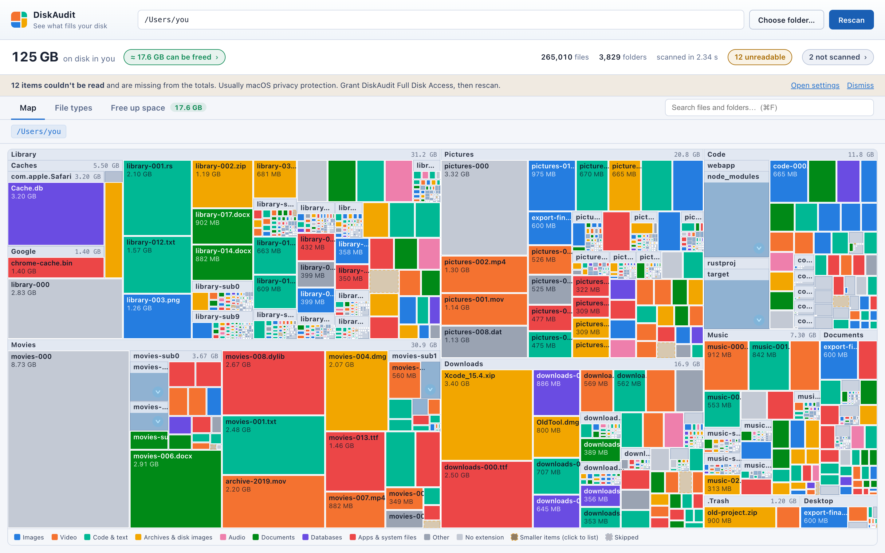

# DiskAudit

**See what fills your disk — on macOS, Windows and Linux.** Point DiskAudit at
a folder or a whole drive and every file becomes a block sized by the space
it actually occupies. Find the big thing, understand what it is, and decide
what to do about it. DiskAudit itself never changes anything.



DiskAudit is built around one loop:

1. **Find** — the map starts filling in seconds into a scan and keeps
   refining live. The biggest blocks are the answer to "where did my space
   go?"
2. **Understand** — click to drill in, hover for exact sizes and paths,
   search for things like *every video over 1 GB*, browse the **File types**
   breakdown, open the full listing behind any "N smaller items" block.
3. **Act** — right-click any file or folder: show it in Finder / File
   Explorer / your file manager, **Copy Path**, or **Copy Delete Command**
   (puts a command on the clipboard for *you* to paste into Terminal or
   PowerShell — see the guarantee below). Or drop a folder onto the window
   to scan it.
4. **Free up space** — the tab that answers the question the map leaves
   hanging: *which of these bytes don't I need?* Caches, build artifacts,
   the trash, old installers, verified duplicate files and stale-file hints,
   each labeled with **why** it can go and how safe that is — plus
   reviewable exports and a deliberately careful cleanup-script generator.

| Start here | What can be freed, and why |
| --- | --- |
|  |  |

| File types | Light mode |
| --- | --- |
|  |  |

*(Screenshots show the built-in demo dataset rendered by the development
mock — run a scan to see your own disk.)*

## Platform support

| | macOS 11+ | Windows 10/11 | Linux (x64, GTK/WebKit) |
| --- | --- | --- | --- |
| Size on disk | `st_blocks` | NTFS allocation size (sees compression, sparse files, OneDrive placeholders) | `st_blocks` (matches `du` exactly) |
| Hardlinks counted once | yes | yes (volume serial + file index) | yes |
| Stays on one volume | APFS System+Data shown merged; other volumes skipped | junctions, symlinks and mount points are never followed | other filesystems skipped (incl. `/proc`, `/sys`, separate `/home`, btrfs subvolumes) |
| Units | decimal, like Finder | 1024-based, like File Explorer | decimal, like GNOME Files |
| Known cleanup spots | `~/Library/Caches`, Xcode, Trash, iOS backups | `%TEMP%`, browser and tool caches, Recycle Bin, Windows Update downloads | `~/.cache`, Flatpak caches, Trash, apt/dnf/pacman caches |
| Cleanup script | bash, moves to `~/.Trash` | PowerShell, moves to the Recycle Bin | bash, `gio trash` |
| Tested by | unit tests + `du` comparison on the developer machine and in CI | unit tests in CI; **not yet exercised by hand on a real Windows machine** | unit tests + `du` comparison in a container and in CI; **GUI not yet exercised by hand** |

The scanner, its store and the cleanup detector live in a UI-free Rust crate
(`src-tauri/core`); everything OS-specific sits behind
`src-tauri/core/src/platform/`, one module per OS.

## The read-only guarantee

DiskAudit **never writes, moves, renames, or deletes anything**. This is
enforced in three layers:

- The Rust scanner uses only read APIs (`metadata`, `read_dir`, directory
  traversal; duplicate detection additionally opens files **read-only** to
  hash their contents). There is no code path that opens a file for writing,
  removes anything, or spawns a process. On Windows the scanner additionally
  opens a metadata-only handle per file (no read or write access) to learn
  its size on disk. An audited security comment at the top of
  `src-tauri/src/lib.rs` documents the allowed API surface.
- The UI layer (Tauri) is granted **no filesystem capability at all** — just
  the folder-open dialog, "show in the file manager", and *write-only* clipboard
  access. Each grant is justified in `src-tauri/capabilities/default.json`.
- Everything the app produces to act on — the single "Copy Delete Command",
  the Free up space tab's exports, and its generated cleanup scripts — is
  **plain text placed on the clipboard**. DiskAudit never saves any of it to
  disk (no export files, no temp files) and has no code path that executes a
  script or shell command. Deleting remains a deliberate act you perform
  yourself in Terminal or PowerShell.

## Free up space

The **Free up space** tab lists space you could plausibly free, **grouped by the
reason it's reclaimable** — because the reason determines how safe acting on
it is:

- **Comes back by itself (safe).** App caches (`~/Library/Caches/*` on
  macOS, `~/.cache/*` and Flatpak caches on Linux, browser caches on
  Windows), developer tool caches (npm, cargo, Go, Gradle, pip, NuGet),
  system package caches (apt/dnf/pacman downloads, Windows Update
  downloads — shown, but left to the system's own cleanup tool), Xcode
  DerivedData / device support / simulator caches, and build artifacts
  (`node_modules`, Rust `target`, `Pods`, `.venv`, `__pycache__`, `.next`,
  Go/PHP `vendor`). Deleting these costs rebuild/re-download time, not data.
- **Genuinely disposable, but gone for good (careful).** Trash / Recycle Bin
  contents, leftover folders in Windows temp directories, installers
  (`.dmg`/`.pkg`, `.msi`/`.iso`, `.deb`/`.rpm`…) sitting in Downloads for
  30+ days, Xcode archives, and iOS device backups (the last two are here — not
  under "safe" — because they do *not* regenerate).
- **Duplicates (careful).** Files with byte-identical content at several
  paths, verified by hashing in a separate, explicitly-started, cancellable
  pass (size grouping → head/tail sample → full hash, so only files that
  already collided twice are fully read; the tab reports how much I/O it
  actually did). The reclaimable figure is the group total **minus one kept
  copy** — the kept copy is marked and never counted. Hardlinks are excluded
  outright (deleting one path frees nothing).
- **Stale (a hint, not a verdict).** Files over 500 MB not modified in over a
  year — judged by **modification time**, because access times are
  unreliable on every OS. Never flagged in app-managed or system territory
  (`~/Library`, `AppData`, `Program Files`, dot-directories, `/usr`…) or
  inside package-like folders (`.app`, `.photoslibrary`, …).

Detection is **deliberately conservative**: ambiguous names need
corroborating markers (`target` only counts with a sibling `Cargo.toml`,
`.venv` needs `pyvenv.cfg`, bare `build`/`dist` are never flagged), nothing
outside the scan root or touching skipped territory is ever offered, and a
quiet tab means "nothing matched the rules", not "nothing could be freed".
The headline number is a deduplicated union — a duplicate inside a flagged
`node_modules` is never counted twice.

**Exports** (selected findings or all of them): CSV — the default, with
path, size, kind, category, confidence and reason, meant to be reviewed in a
spreadsheet before anything is deleted — plus plain paths and JSON. Every
export carries provenance: scan root, timestamp, total, DiskAudit version.

**Deletion scripts** are generated from your explicit selection only
(nothing is ever pre-selected), and are the most carefully engineered text
the app produces:

- **Move to the Trash / Recycle Bin by default** (recoverable); permanent
  delete is an explicit, clearly-labeled alternative. On Windows, if an item
  is too large for the Recycle Bin, Windows asks before deleting it.
- **bash on macOS and Linux, PowerShell on Windows.** The PowerShell script
  is plain ASCII (non-ASCII file names are spelled as character codes), so
  it means the same thing however it is saved, and it never follows a
  junction or symlink while deleting.
- **Dry-run by default**: the script previews and exits unless run with
  `--yes`.
- Strict mode; every path quoted for its shell; a review comment (size,
  category, why) above every entry; a provenance header.
- Every step re-checks the path still exists, skips and reports anything
  missing, never lets one failure abort the rest, and prints a `du`-measured
  running total to reconcile against DiskAudit's estimate.
- The generator **refuses** dangerous paths — the filesystem or drive root,
  your home, `~/Library` / `AppData` / `Windows` and other protected
  locations, the Recycle Bin itself, system package caches, anything outside
  the scan root, nested selections — and lists what it refused instead of
  emitting it.

And to repeat the guarantee: script and exports are **clipboard text**. The
app never writes them to disk and can never run them.

## Install / build

Tagged releases build installers for all three platforms (`.dmg`, `.msi` /
`.exe`, `.deb` / `.rpm` / `.AppImage`) through
`.github/workflows/release.yml`. They are **unsigned** unless signing secrets
are configured, so macOS Gatekeeper and Windows SmartScreen will warn on
first launch.

To build from source you need [Rust](https://rustup.rs), Node 20+, and the
platform's Tauri prerequisites (Xcode command-line tools on macOS; the
WebView2 runtime and MSVC build tools on Windows; `libwebkit2gtk-4.1-dev`,
`librsvg2-dev` and friends on Linux — see
[tauri.app/start/prerequisites](https://tauri.app/start/prerequisites/)).

```bash
npm install
npm run tauri dev     # run in development
npm run tauri build   # produce the installers for the OS you are on
```

Bundles land in `src-tauri/target/release/bundle/`.

## When items can't be read

A scan never fails because of a locked folder: it counts what it couldn't
read, shows the number next to the totals, and tells you what to do.

- **macOS** blocks every app from Mail, Messages, Safari data and parts of
  `~/Library` until you grant **Full Disk Access** (System Settings →
  Privacy & Security). DiskAudit offers a button that opens that pane.
- **Windows** protects other users' profiles and system folders; run
  DiskAudit as administrator to include them.
- **Linux**: folders owned by root or other users are reported as unreadable.

## How DiskAudit measures — and how that relates to your file manager

- **Sizes are allocated bytes**: the space a file really occupies on disk,
  which is what you get back by deleting it. File managers usually headline
  the *logical* size (what the file claims to contain); DiskAudit reports
  the logical total in the File types view for comparison. Sparse files
  (Docker images, VM disks), compressed files and cloud placeholders can be
  dramatically smaller on disk than their logical size — DiskAudit shows the
  truth.
- **Units follow the host**: decimal (1 MB = 1,000,000 bytes) on macOS and
  Linux, 1024-based on Windows, so numbers line up with the file manager
  next to the app.
- **Hardlinks are counted once.** Extra links to the same file show as 0 bytes
  and the deduplicated total is reported in the File types view.
- **Directories count their own blocks** where the filesystem gives them any
  (ext4, XFS: about 4 KiB each; APFS and NTFS: none counted). This is what
  makes Linux totals equal `du`.
- **APFS clones are not deduplicated** — macOS provides no public API to
  detect shared extents. Two clones of a 10 GB file count as 20 GB (Finder
  does the same); actual disk usage may be lower. The same is true of
  reflinks on btrfs and XFS.
- **Scanning `/` on macOS shows the startup disk the way Finder presents it**:
  the System and Data volumes merged at their usual paths. The Data volume's
  mount point (`/System/Volumes/Data`) is skipped so nothing is counted
  twice.

## What a scan deliberately skips

Nothing disappears silently — every skipped location appears in the map, in
listings, and in the **not scanned** panel with its reason:

- **Cloud-sync mounts on macOS** (`~/Library/CloudStorage`, `~/Library/Mobile
  Documents`): much of their content lives only in the cloud, and reading
  them can hang on network I/O. (On Windows, OneDrive folders *are* scanned:
  online-only files simply occupy 0 bytes, and reading metadata never
  downloads anything.)
- **Other volumes and filesystems**: external drives, network shares, disk
  images, and on Linux anything mounted separately. Scan one directly to
  measure it.
- **Links are never followed** — symlinks everywhere, junctions and mount
  points on Windows. Each is counted where it stands, at the link's own ~0
  size, so nothing is counted twice and scans can't loop.

## Known limitations

- **Windows and Linux are new in 1.2.** The scanner is tested on both in CI,
  and on Linux its totals are checked against `du`; the Windows size and
  hardlink code paths and the PowerShell "move to Recycle Bin" action have
  not yet been confirmed by hand on real machines. Treat the first Windows
  numbers as something to sanity-check against a folder's Properties dialog.
- On Windows every file costs one extra metadata handle to learn its
  allocation size, so scans are slower than tools that read the NTFS master
  file table directly (which needs administrator rights; DiskAudit does not).
- Space that the OS reclaims on demand (APFS local snapshots, purgeable
  iCloud content, Windows restore points and shadow copies) is invisible to
  any user-space walk.
- Which of several hardlinked paths displays the shared size depends on scan
  order.
- The scanner keeps the whole scan in memory to serve drill-in, listing, and
  search queries instantly afterward; very large scans (millions of files)
  cost a few hundred MB of RAM.
- **Clones and reflinks are indistinguishable from real copies** in user
  space, so duplicate detection may list them — deleting one frees (almost)
  nothing. Treat duplicate findings inside photo libraries with care.
- Cleanup detection is deliberately conservative and **under-reports**:
  Docker's data is never flagged, bare `build`/`dist` folders are never
  flagged, `.exe` and `.AppImage` files are never called installers, and
  small findings are dropped below a floor. An empty tab means nothing
  matched the rules, not that nothing could go.
- Map colours distinguish eight kinds of file. With more kinds than that no
  palette stays readable for colour-blind users, so kinds are grouped, and
  every block also carries a label, a tooltip and a row in the listings.

## Development

```bash
npx tsc -b --force            # type-check the frontend
npm test                      # frontend tests (vitest)
npm run dev                   # UI in a plain browser against a mock backend
                              #   add ?os=windows or ?os=linux to preview those
cd src-tauri
cargo test --workspace        # scanner + reclaim tests
cargo run --release -p diskaudit-core --example scan_summary -- ~/Library
                              # CLI harness, compares to du
```

CI runs on macOS, Windows and Linux: `cargo fmt --check`, `clippy -D
warnings` and tests for the core crate, a `du` comparison, `tsc` and vitest
(including executing the generated bash and PowerShell scripts), and a full
app build.

Architecture notes live in [CLAUDE.md](CLAUDE.md).
